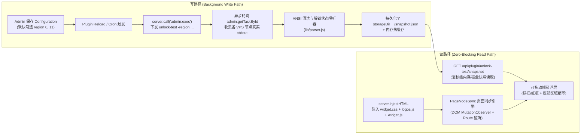

# Komari Plugin UnlockTest — 生产级开发计划 (Development Plan)

> **历史开发计划**：保留早期需求与方案记录；当前实现以 [specification.md](specification.md) 为准。

## 1. 需求确认基线 (Confirmed Baseline)

1. **配置页勾选粒度**：
   - 按 `MediaUnlockTest` 的 12 个区域（`-region 0` ~ `11`）进行勾选配置，**默认勾选 `0`（跨国平台 Globe）与 `11`（AI 平台 AI）**。
   - 保存配置后自动合成 `unlock-test -region <ids> -m <ip_mode> -conc <conc> -show-active=false` 参数并在后台异步执行。
2. **多台 VPS 节点的浮层交互与页面同步**：
   - 采用浮层顶部 `<select>` 下拉菜单选择节点，并保持与当前 Komari 页面实时同步：
     - **分组/搜索筛选同步**：当用户在首页进行分组筛选或搜索（例如 10 个节点中当前页面仅展示 3 个节点卡片）时，浮层下拉菜单动态收敛为仅包含当前页面可见的这 3 个节点；
     - **单节点详情页同步**：当用户点开单个 VPS 的详情页（如 `/instance/<uuid>` 或点击节点卡片进入详情视图）时，下拉菜单自动选中当前 VPS 节点并展示其解锁矩阵。
3. **IPv4 / IPv6 双栈结果展示规则**：
   - 沿用 Phase 1 原型设计：浮层提供 `ALL / IPv4 / IPv6` 协议切换按钮；
   - `ALL` 模式下任一栈解锁即判定为可解锁（绿色边框 `#10b981`），底部显示解锁区域缩写小字（如 `US`、`JP`、`HK`、`SG`）；若均未解锁则显示红色边框（`#ef4444`）及状态标识（`NO` / `ERR`）。
4. **插件配置页承载方式**：
   - 采用 `komari-plugin.json` 原生声明式 `configuration`（`type: "managed"`），由 Komari 管理后台直接渲染托管配置表单并在保存时触发插件热重载（`plugin.Reload`）。

## 2. 系统架构与读写分离设计 (Architecture)

## 3. 并行开发模块划分 (Parallel Sub-Agent Workstreams)

| 模块编号 | 模块名称 | 产出文件路径 | 核心职责与验收标准 |
| :--- | :--- | :--- | :--- |
| **Workstream 1** | **插件清单与托管配置 (Manifest & Config)** | `plugin/komari-plugin.json` | 声明插件元数据、权限（`node`、`allowRoutes`、`allowSystemRPC`、`allowHTMLInject`）及 `managed` 配置项（`region_0`~`region_11` 默认开启 `0` 和 `11`、连接模式 `-m`、并发数 `-conc`、Cron 周期、目标节点选择器）。 |
| **Workstream 2** | **MediaUnlockTest 解析引擎 (Output Parser)** | `plugin/lib/parser.js` | 对接 `MediaUnlockTest` 真实 CLI 输出格式（支持标准分组输出与 `--table` 表格输出），剥离 ANSI 控制符，提取各区域下每个服务的 IPv4/IPv6 解锁布尔值、区域缩写（`Region`）与附加信息。 |
| **Workstream 3** | **后台探测调度与快照服务 (Probe & Server)** | `plugin/lib/probe.js` `plugin/script.js` | 实现读写分离：后台通过 `admin:exec` 自动检测/安装 `unlock-test` 二进制并按 `-region` 执行探测，轮询 `admin:getTaskById` 写入 `__storageDir__/snapshot.json`；暴露 `GET /api/plugin/unlock-test/snapshot` 与 `POST /api/plugin/unlock-test/probe`。 |
| **Workstream 4** | **流媒体与 AI 品牌矢量图标库 (Logo Assets)** | `plugin/assets/logos.js` | 内置跨国平台（Netflix, Disney+, YouTube, TikTok, Spotify, Prime Video, Apple, Steam, Bilibili 等）、AI 平台（ChatGPT, Claude, Gemini, Copilot, Perplexity, Grok, DeepSeek 等）及各区域主流平台的高清 SVG 图标与自适应徽章渲染器。 |
| **Workstream 5** | **可拖动浮层与页面节点同步引擎 (Frontend Widget)** | `plugin/assets/widget.css` `plugin/assets/widget.js` | 实现 ≥16px 终端风可拖动浮层、绿/红边框与底部区域小字、`ALL/IPv4/IPv6` 过滤、DOM 分组筛选与单节点详情页自动同步、`localStorage` 持久化、JSON 导出/导入备份、中英双语切换及 About Modal。 |
| **Workstream 6** | **打包脚本与 Komari 运行时集成验证 (Build & Test)** | `build.sh` `README.md` | 编写一键构建脚本生成标准 `dist/unlock-test.zip`，并通过 Komari Go 插件引擎单元测试验证 `InstallZip`、`SetEnabled`、配置默认值合并、HTML 注入与快照路由。 |

## 4. 关键技术规范与边界处理

- **非阻塞加载**：`load()` 钩子在注册路由、静态目录、Cron 与 HTML 注入后立即返回；首次探测任务通过 `setTimeout` 异步投递至事件循环，绝不阻塞 Komari 启动或配置保存。
- **VPS 端自动安装与执行**：下发至 VPS 的命令优先复用已安装的 `unlock-test`（`/usr/bin/unlock-test`、`/usr/local/bin/unlock-test`、`~/.local/bin/unlock-test` 或 `/tmp/unlock-test`）；若未安装则按系统架构自动拉取 `https://unlock.icmp.ing/test/latest/unlock-test_${os}_${arch}` 后执行 `-region <regions> -m <mode> -conc <conc> -show-active=false`。
- **页面节点同步 (`PageNodeSync`)**：
  1. 监听 URL 路由变化（`popstate`、`hashchange`、`history.pushState`/`replaceState`）与 DOM 变化（`MutationObserver`）。
  2. 若当前 URL 路径/查询参数匹配某个节点的 `uuid`（例如 `/instance/<uuid>`）或处于 `.km-page-instance` 详情页，自动选中该节点。
  3. 若处于首页列表/网格视图，扫描当前页面可见的节点 DOM 元素（`.km-node-card`、`.km-instance-server-item`、`a[href*="/instance/"]`、`[data-uuid]` 及包含节点名称的可见卡片），将浮层下拉菜单选项实时过滤为当前页面可见的节点集合。
