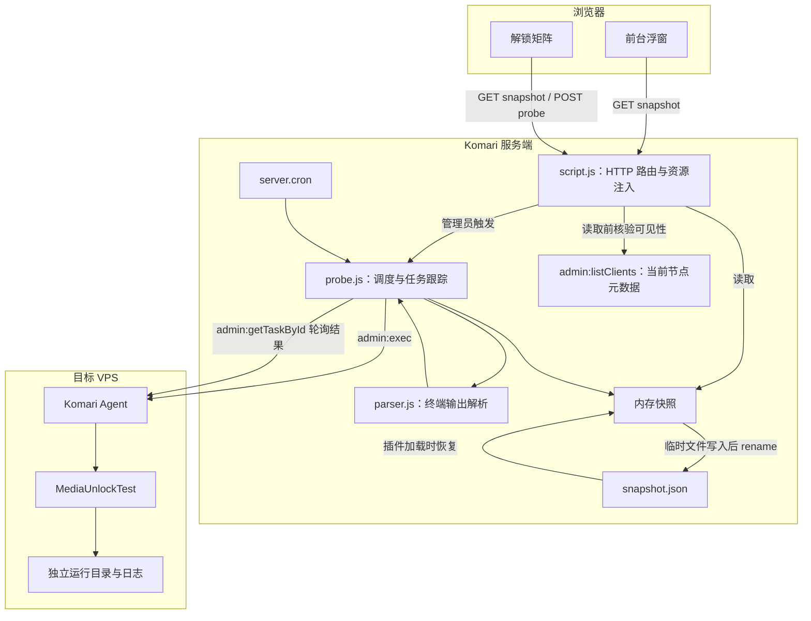
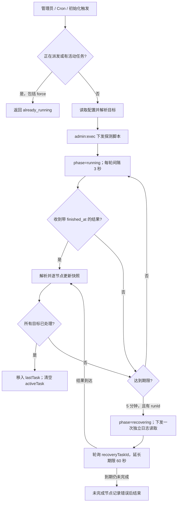

# Technical Specification: Komari-Plugin-UnlockTest

> **实现版本**：`26.1020.3`
> **宿主要求**：Komari `>=1.0.5`，服务端使用 Goja JavaScript 运行时。
> **维护原则**：本文记录当前代码的架构、数据模型、接口与运行边界。核心流程、路由或数据结构变更时同步更新；开发与发布操作约定见 [agent.md](agent.md)。

## 1. 系统架构

插件通过 Komari 官方 Agent 通道执行 MediaUnlockTest，将解析结果保存为快照，供前台浮窗和后台矩阵读取。节点无需向插件发起 HTTP 回调，也无需安装额外常驻服务，插件不要求配置回调地址或回调密钥。



读路径不触发 VPS 探测或第三方检测请求，但 HTTP 快照接口会等待本地 `admin:listClients` 核验可见性，因此不承诺固定的 `<1ms` 响应时间。探测、取消和日志恢复均由后台调度器通过 `admin:exec` 下发。

## 2. 模块职责

| 路径 | 职责 |
| --- | --- |
| `plugin/komari-plugin.json` | 版本、宿主兼容性、权限、managed 配置和管理页面注册 |
| `plugin/script.js` | `load/unload`、HTTP/RPC 注册、静态目录挂载、HTML 注入、延迟初始化 |
| `plugin/lib/probe.js` | 配置归一化、节点解析、任务互斥、远端命令、结果轮询、取消、恢复、快照与诊断 |
| `plugin/lib/parser.js` | 去除 ANSI 控制码，解析区域、IPv4/IPv6/Auto 结果与元信息 |
| `plugin/assets/widget.js` | 浮窗、节点聚焦、路由感知、拖拽、快照刷新、诊断展示 |
| `plugin/assets/widget.css` | 浮窗、卡片、弹窗及手机适配样式 |
| `plugin/assets/logos.js` | 服务 SVG 图标映射 |
| `plugin/pages/matrix.html` | 双向冻结矩阵、动态服务列、筛选、定向探测与实际任务进度 |
| `tests/probe.test.js` | 解析、调度、HTTP、可见性、恢复及远端脚本回归测试 |
| `tests/widget-browser.cjs` | 桌面/手机浮窗与旧偏好迁移的浏览器检查 |
| `tests/matrix-browser.cjs` | 矩阵空状态、注入防护、区域标识、请求失败与结果刷新的浏览器检查 |
| `tests/fixtures/` | 测试用终端输出样本，不进入插件分发包 |
| `dist/unlock-test.zip` | 本地测试包唯一输出位置 |
| `build.sh` | 本地版本递增、ZIP 打包、插件索引及校验值同步 |
| `.github/workflows/release.yml` | 发行包构建、Release 附件上传及插件索引回写 |
| `v1.json` | 插件源索引，包含版本、下载地址和 SHA-256 |
| `RELEASE_NOTES.md` | 当前版本中英文发布说明 |

分发包以 `plugin/` 内容为根目录，包含清单、入口以及 `lib/`、`assets/`、`pages/`；仓库文档、原型、测试及参考项目不进入分发包。

## 3. 配置与初始化

服务端模块使用 CommonJS 的 `require()` / `module.exports`，入口通过 `load()` 和 `unload()` 管理生命周期；不能将浏览器脚本直接当作 Goja 模块加载。清单启用 `node`、`allowRoutes`、`allowSystemRPC`、`allowHTMLInject`，运行时 `timeout` 为 `30`，`maxHTTPBodyBytes` 为 `524288`。该运行时超时与远端检测进程、后台任务的分钟级期限分别配置。

### 3.1 配置归一化

| 配置 | 当前行为 |
| --- | --- |
| `region_0` … `region_11` | 12 个区域开关，默认开启 `0`（Globe）和 `11`（AI）；全部关闭时仍回退到 `0,11` |
| `ip_mode` | `0` 自动双栈、`4` IPv4、`6` IPv6；非法值回退 `0`。模式 `0` 不显式传入 CLI 的 `-m` |
| `concurrency` | 默认 `30`；取整并限制最大 `200`；非法或负数回退 `30`；`0` 传给 CLI，表示不限制并发 |
| `cron_spec` | 默认 `0 */6 * * *`；每个运行时注册一次；配置无效时记录错误 |
| `target_nodes` | 接受数组或 JSON 数组字符串；空配置表示自动选择在线节点 |
| `auto_probe_on_save` | 默认开启；配置签名变化或整个快照没有节点数据时自动触发 |

配置签名由区域、IP 模式、并发数和排序后的目标节点组成，不包含 Cron 表达式与自动探测开关。当前自动探测条件不是逐个扫描新增节点：已有节点快照、签名未变化时，不会仅因出现一个新节点就立即补测。

### 3.2 初始化与卸载

1. `load()` 创建调度器并读取磁盘快照，注册路由、RPC、静态目录和注入资源。
2. 延迟 `800ms` 调用 `syncConfigAndMaybeProbe()`，加载配置、注册 Cron，并恢复持久化的活动任务。
3. 可恢复任务优先继续轮询；没有运行标识的过期旧任务结束并记录错误；没有活动任务时再判断是否自动探测。
4. `unload()` 清除初始化定时器，调度器标记卸载并停止轮询。已下发到 VPS 的进程不会因插件卸载自动结束；重新加载可恢复任务跟踪，远端另有超时保护。

## 4. 数据模型与快照

### 4.1 持久化快照

存储路径为 `__storageDir__/snapshot.json`；未提供运行时目录时回退当前目录。内存快照优先，首次读取磁盘失败时创建空快照。保存时先写 `snapshot.json.tmp` 再重命名；默认写入失败仅记录日志，不能将内存更新等同于持久化成功。

以下接口描述磁盘/管理员视图的主要字段；节点占位记录和失败记录可能缺少执行结果字段。

```typescript
type ISOTime = string;

interface UnlockSnapshot {
  schemaVersion: number;                 // 当前为 1
  configSignature: string;
  regions: string[];                     // 区域 ID，例如 ["0", "11"]
  ipMode: "0" | "4" | "6";
  concurrency: number;
  commandPreview: string;                // 诊断预览，不包含完整远端脚本
  updatedAt: ISOTime | null;             // 整批任务结束时更新
  activeTask: ProbeTask | null;
  lastTask: ProbeTask | null;
  nodes: Record<string, NodeUnlockRecord>;
  telemetry: {
    lastTaskId: string;
    lastProbeStartedAt: ISOTime | null;
    lastProbeFinishedAt: ISOTime | null;
    lastProbeDurationMs: number;
    lastProbeNodeCount: number;
    totalProbesRun: number;
    lastError: string | null;
  };
}

interface ClientMeta {
  uuid: string;
  name: string;
  group: string;
  region: string;
  hidden: boolean;
}

interface ProbeTask {
  taskId: string;                        // Komari 返回的 task_id，不保证为 UUID
  runId?: string;                        // 旧快照可能没有；新任务均生成
  startedAt: ISOTime;
  deadlineAt: ISOTime;
  clients: string[];
  clientMeta: Record<string, ClientMeta>;
  completed: Record<string, boolean>;
  phase: "running" | "recovering";
  elapsedSeconds: number;
  finishedCount: number;
  totalCount: number;
  nodeSummary: Record<string, {
    finished: boolean;
    exitCode: number;
    finishedAt: ISOTime;
    error: string | null;
    webSshDisabled: boolean;
  }>;
  recoveryTaskId?: string;
  cancelRequested?: boolean;
  lastPolledAt?: ISOTime;
  lastPollError?: string | null;
  finishedAt?: ISOTime;
  durationSeconds?: number;
  error?: string | null;
}

interface NodeUnlockRecord {
  uuid: string;
  name: string;
  group?: string;
  nodeRegion?: string;                    // 节点所属区域，与服务解锁地区分开
  hidden: boolean;
  exitCode?: number;
  finishedAt?: ISOTime;
  updatedAt?: ISOTime | null;
  lastAttemptAt?: ISOTime;
  taskId?: string;
  meta: Partial<ProbeMeta>;
  services: ServiceStatus[];
  webSshDisabled?: boolean;
  error: string | null;
  rawOutputSnippet?: string;             // 原始输出前 600 个 JS 字符单位
}

interface ProbeMeta {
  testTime: string;
  ipv4: string;
  ipv4Region: string;
  ipv4Isp: string;
  ipv6: string;
  ipv6Region: string;
  ipv6Isp: string;
  statsText: string;
}
```

任务结束时将对象移到 `lastTask` 并清空 `activeTask`，不会把 `phase` 改成 `success/failed`。完成状态应结合 `activeTask` 是否为空、`finishedAt` 和 `error` 判断。`finishedCount` 统计已接收并处理的节点结果，失败结果也计入完成数。

### 4.2 服务与协议栈结果

```typescript
interface StackStatus {
  status: "YES" | "NO" | "RESTRICTED" | "BANNED" | "ERR" | "UNKNOWN";
  unlocked: boolean;
  region: string;
  info: string;
  raw: string;
}

interface ServiceStatus {
  id: string;                           // 原始服务名小写化、非字母数字替换为连字符
  name: string;
  displayName: string;
  regionId: string;
  regionKey: string;
  subCountry: string;
  ipv4: StackStatus | null;
  ipv6: StackStatus | null;
  auto: StackStatus | null;
  unlocked: boolean;                    // 任一协议栈解锁即为 true
  region: string;                       // 综合展示标签，可为地区、机场代码或状态缩写
}
```

解析器按 `regionId + "::" + 原始服务名` 合并双栈输出；矩阵按 `regionId + "::" + (service.id || service.name)` 建立列与节点结果索引。`id` 本身不保证跨区域唯一。协议栈状态通过 `ipv4/ipv6/auto` 对象读取，四态徽章属于浏览器展示投影。

### 4.3 HTTP 快照投影与可见性

`GET /snapshot` 的 `data` 包含 `schemaVersion`、`regions`、`regionsCatalog`、`ipMode`、`concurrency`、`commandPreview`、`updatedAt`、`activeTask`、`lastTask`、`nodes` 和 `telemetry`，不直接返回磁盘快照的 `configSignature`。

- 每次 HTTP 读取先通过本地 `admin:listClients` 刷新元数据，清除已删除节点，更新名称、分组、区域和隐藏状态。读取失败返回 `503`。
- 当前存在但没有快照的节点可以返回占位记录：`services: []`、`meta: {}`、`updatedAt: null`、`error: null`。
- 管理员可读取隐藏节点和完整任务记录。访客只读取当前可见节点，节点的 `rawOutputSnippet`、`meta.ipv4`、`meta.ipv6` 不进入 JSON，具体错误替换为通用提示。
- 访客任务对象只保留 `startedAt`、`finishedAt`、`elapsedSeconds`、`phase`、可见 `clients`、`totalCount` 和 `finishedCount`；不返回任务 ID、运行标识、内部节点元数据或逐节点诊断。
- 访客 `telemetry` 只包含脱敏后的 `lastError`。

## 5. HTTP 与 RPC 接口

### 5.1 HTTP

动态路由均设置 JSON Content-Type 与 `Cache-Control: no-store`，通过 `res.end(JSON.stringify(...))` 完成响应。

| 方法 | 路径（前缀 `/api/plugin/unlock-test`） | 行为与权限 |
| --- | --- | --- |
| GET | `/snapshot` | 按宿主请求身份投影快照；成功 `200`，无法核验当前可见性 `503` |
| POST | `/probe` | 管理员触发/取消；无权限 `403`，请求格式错误 `400`，派发失败 `503`，抛出异常 `500` |
| GET | `/debug` | 管理员诊断；无权限 `403` |
| GET | `/assets/*` | 静态挂载 `assets/` |
| GET | `/pages/*` | 静态挂载 `pages/`，包含 `matrix.html` |

管理员判断使用宿主提供的 `req.context.role === "admin"` 或 `req.context.principal.roles`。插件不把任意 Bearer 请求头当成管理员身份；身份认证由 Komari 负责。

探测请求为 JSON 对象：

```json
{
  "clients": ["node-uuid"],
  "force": false,
  "cancel": false
}
```

- `clients` 可省略；提供时必须是字符串数组。当前接口字段为 `clients`。
- 省略 `clients` 时，使用配置目标节点或全部节点，再保留 `online === true` 的节点；状态查询失败或无在线节点时不回退全节点下发。
- 显式 `clients` 会去重并过滤不存在的 UUID，覆盖配置目标范围，且不按在线状态过滤；离线结果由宿主执行通道反馈。`[]` 不扩展到默认范围。
- 已有任务或正在派发时，包括 `force: true` 在内的重复请求返回 `reason: "already_running"`；HTTP `200`，不创建第二个探测任务。
- 无活动任务时 `cancel: true` 返回成功的空操作；有新格式任务时请求远端取消，返回 `cancelled: true` 表示请求已发出，不表示进程已经退出。缺少 `runId` 的旧任务继续等待其结果或期限。
- 正常触发、取消请求和重复请求均返回 `{status: "success", data: ...}`。无可用目标或派发失败返回 `{status: "error", ...}`。

清单将矩阵注册为 `visibility: "admin"` 的管理菜单页面；`/pages/*` 的静态挂载本身没有额外管理员判断。直接访问静态页面不能绕过探测、诊断接口的权限检查，读取的快照仍按调用者身份过滤。

### 5.2 Komari 核心 RPC

| 方法 | 插件使用的参数 | 用途 |
| --- | --- | --- |
| `admin:listClients` | 无 | 当前节点元数据，不等同于在线节点列表 |
| `common:getNodesLatestStatus` | 无 | UUID 到状态的映射，用于自动任务的在线筛选 |
| `admin:exec` | `{command, clients}` | 下发探测、取消或日志恢复命令，读取响应中的 `task_id` |
| `admin:getTaskById` | `{task_id}` | 读取 `results` 数组；使用 `client`、`result`、`exit_code`、`finished_at` |
| `admin:getAgentStartupConfig` | `{uuid}` | 在结果失败或未解析到服务时检查远程执行是否被禁用；插件侧等待上限 `2500ms`，无法确认时返回未知 |

插件通过 `server.registerRPC` 注册 `unlockTest:getSnapshot`、`unlockTest:getDebugInfo`、`unlockTest:triggerProbe`。前两者返回管理员视图；触发方法只转发可选的 `clients`，不转发 `force/cancel`。这些入口由宿主 RPC 权限控制，不复用 HTTP 路由的身份检查；RPC 快照方法也不主动刷新节点元数据。

### 5.3 诊断

`GET /debug` 返回时间、存储路径及存在状态、活动/最近任务、配置签名、命令预览、区域、统计和节点摘要。节点摘要包括退出码、服务数、解锁数、错误、Web SSH 状态及前 `160` 个字符单位的输出预览。内存日志最多保留 `100` 条，诊断接口返回最近 `40` 条。当前实现没有可配置的日志级别开关。

## 6. 探测状态机与远端保护



轮询使用链式 `setTimeout(3000)`，一轮 RPC 和处理结束后再安排下一轮，不承诺固定的墙钟间隔。首次期限从成功派发任务时开始计算，为 `300000ms`。

### 6.1 远端运行目录与互斥

- 每次新任务生成 `runId`；命令构造器只接受 1–100 位字母、数字及连字符。
- 使用 `umask 077` 和 `/tmp/km-unlock-<runId>/`，保存 `output.log`、`exit`，取消时写入 `cancel` 标记。已有同名目录时拒绝启动。
- 通过创建 `/tmp/km-unlock-$(id -u).lock` 目录互斥，同一系统用户已有探测时新命令以 `75` 退出。正常退出清理锁；当前没有针对残留锁的自动回收逻辑。
- 执行结束后先写 `exit.tmp` 再重命名为 `exit`，最后输出日志并返回退出码。恢复命令必须找到 `exit` 才读取日志，不读取旧的共享日志文件，也不再次运行检测程序。
- 取消命令检查对应运行目录及所有者后写入 `cancel`。监控进程周期检查标记并发送终止信号，必要时再发送强制终止信号；调度器保持活动任务跟踪。

### 6.2 二进制与资源保护

- 优先检查 `/usr/bin/unlock-test`、`/usr/local/bin/unlock-test`、`$HOME/.local/bin/unlock-test` 及 PATH 中的程序，确认 `-h` 包含 `-region` 后复用。
- 没有兼容程序时，根据 OS 和 CPU 架构从 `https://unlock.icmp.ing/test/latest/` 下载到本次运行目录；可写 `/usr/bin` 时尝试复制供后续复用。下载到运行目录的程序在退出清理时移除。
- 读取 `/proc/meminfo`，当 `MemTotal < 360000 kB` 时设置 `GOMAXPROCS=1`、`CONC=5`。这是降低低内存风险的策略，不保证杜绝 OOM。
- 有 `timeout` 时使用 `timeout -k 5 240`；同时启动监控进程，在取消或运行约 `240s` 时终止执行，随后最多等待约 `5s` 再尝试强制结束。下载与程序发现发生在执行计时之前。
- 非零退出码或没有解析出服务时记录节点错误；有解析结果则使用该结果，否则保留旧服务数据。错误存在且有旧 `updatedAt` 时保留旧时间，另记 `lastAttemptAt`。
- 每次已完成结果只处理一次，部分结果不会结束整批任务。轮询和节点诊断恢复后检查任务是否仍有效，防止卸载后的迟到结果覆盖快照。

## 7. 浏览器交互

### 7.1 前台浮窗

- 通过 `server.injectHTML` 注入 CSS、图标库和浮窗脚本。收起图标为 `48×48px`；展开时默认居中，CSS 基础宽度 `440px`，最大宽度为 `calc(100vw - 20px)`，不是固定占视口一半的面板。
- 支持鼠标/触控拖拽。`komari_unlock_test_widget_v1` 保存选中节点、收起状态、面板与图标拖拽位置等偏好。当前每次展开仍强制居中；收起时恢复图标位置，面板位置记录没有用于恢复展开位置。
- 页面节点通过 `/api/nodes` 与实际 DOM 联动，实例详情页自动聚焦相应节点。通过 `/api/me` 的登录状态决定是否展示探测按钮，最终写权限仍由服务端核验。
- 浮窗固定中文，不读取 Komari 当前语言；旧 `lang`、`ipFilter` 偏好加载时丢弃。没有语言切换、导入导出或 `ALL / IPv4 / IPv6` 切换入口。
- 综合展示优先 `ipv4 || auto` 的成功结果，优先栈未成功而 IPv6 成功时标注 `V6`；不重复生成分协议栈卡片。
- 探测操作提供即时扫描占位与耗时反馈，随后根据真实任务和快照更新卡片。节点结果带有 `webSshDisabled: true` 时展示警告横幅，并在诊断中显示远程执行被禁用；底部保留统计、诊断与关于入口。
- 初次启动读取快照，之后通常空闲 `20s`、有活动任务 `4s` 刷新；本地发起探测期间另有 `1500ms` 刷新定时器，诊断弹窗打开时每 `2s` 更新。
- 路由允许首页 `/`、`/index.html` 及对应首页 Hash（含 `#/overview`），或路径/Hash 包含 `/instance`、`/node`、`/server`。iframe、后台、终端、插件页面、登录认证与设置路径优先排除。
- 同时监听 History API、`popstate`、`hashchange`、DOM 变化，并以 `500ms` 周期检查路由；排除场景隐藏浮窗，常规刷新循环不持续读取快照。初始化仍会调用一次读取。

### 7.2 解锁矩阵

- 保留固定服务表头和节点首列；节点与服务都来自真实快照，空快照显示空状态。
- 启用区域来自 `snap.regions`；区域栏仅展示当前配置，分类按钮用于过滤展示，不修改后台配置。服务列从启用区域的实际服务集合发现。
- 搜索按节点名、分组和节点区域筛选；按钮向 `/probe` 提交 `{clients: 当前显示节点 UUID[]}`，不发送 `force`。提交中或有活动任务时禁用探测按钮。
- IPv4/Auto 成功显示绿色地区标签；仅 IPv6 成功显示青色 `V6`；明确 `NO/RESTRICTED/BANNED` 显示红色 `❌`；缺失结果或仅有 `ERR/UNKNOWN` 时显示中性 `-`，提示中保留栈状态。
- 进度使用后台 `finishedCount/totalCount`，完成提示仅在提交任务与 `lastTask.taskId` 对应时出现。存在任务或等待提交任务结束时以 `3s`、空闲以 `15s` 继续刷新。
- 节点、服务、分组与提示使用 DOM 文本接口。快照读取失败时清空矩阵并显示错误，禁用探测；不回退演示数据或模拟成功进度。

## 8. 构建、发布与验证

### 8.1 本地构建

`./build.sh` 按执行环境的当前日期生成 `YY.MMDD.Patch`：同日递增 Patch，不同日从 `.1` 开始。版本写入 `plugin/komari-plugin.json`；生成 `dist/unlock-test.zip` 后计算 SHA-256，将版本、下载地址、校验值及 UTC 更新时间写入 `v1.json`。清单本身没有 SHA-256 字段。

测试包不在项目根目录另存副本。已验收版本为 `26.1020.3`；核对或提交纯文档时不执行会递增版本的构建脚本。

### 8.2 发布流水线

当前 `.github/workflows/release.yml` 触发条件包括：

- 推送 `v*` Tag。
- Release 的 `created`、`published` 事件。
- 手动 `workflow_dispatch`。

各事件都会构建 ZIP 并上传构建产物；Tag 或 Release 事件还将 `RELEASE_NOTES.md` 作为正文并上传发行附件。只有 Tag 引用下执行自动回写，将发行包真实 SHA-256、版本和下载地址提交至 `main` 的 `v1.json`。CI 临时包路径为根目录 `unlock-test.zip`，与本地测试包统一放在 `dist/` 的约定区分。

只推送普通分支上的文档提交不会匹配上述触发条件。正式发布需用户明确指示，遵循项目约定完成验收、双语发布说明、本地带注释 Tag，并提供终端推送命令；用户明确授权代为推送时执行相应推送。不为文档更新移动现有发行标签。

### 8.3 验证范围

`26.1020.3` 已有 30 项自动化回归测试，以及桌面/手机浮窗和矩阵浏览器检查。测试使用的 RPC 响应、节点和输出样本仅存在于 `tests/`。远端脚本测试覆盖互斥、取消、退出码及按运行标识恢复日志；语法校验和 ShellCheck 补充静态检查，实际部署仍以 Komari 环境验收为准。
